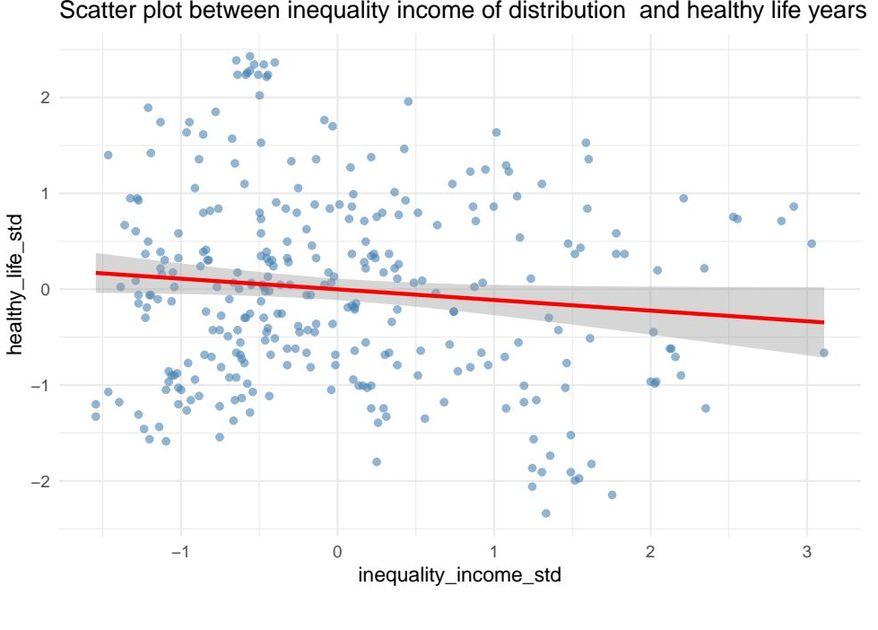
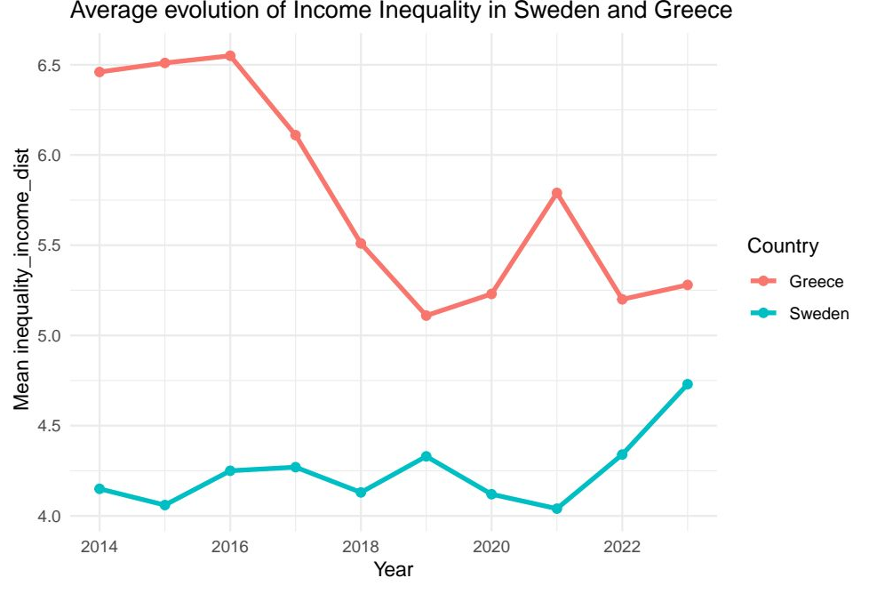

# Income Inequality and Healthy Life Years in Europe (2014–2023)

Do more unequal societies live fewer years in good health? This project studies the relationship between **income inequality** and **healthy life years** across European countries, using Eurostat panel data and regressions with country and year fixed effects.

*Introduction to Programming for Data Analysis — Aix-Marseille School of Economics (AMSE), 2025.*
*Authors: Gildas EDENAKPO & Faïzath ELEKOUN.*

📄 **[Read the full report (PDF)](report/report.pdf)**

---

## Key findings

Income inequality is **negatively associated** with healthy life years in every specification. Coefficients are standardised: they give the change in healthy life years, in standard deviations, associated with a one-standard-deviation increase in inequality.

| Model | Coefficient on inequality | Std. error |
|---|---|---|
| Pooled OLS | −0.11* | (0.06) |
| Country fixed effects | −0.19** | (0.08) |
| Country + year fixed effects | −0.16* | (0.08) |

*308 country-year observations with both variables available. \* p < 0.10, \*\* p < 0.05.*

- The relationship holds when comparing each country with itself over time, so it is not only driven by permanent differences between countries such as health systems or development level.
- In the most complete model, the effect is significant at the 10% level.
- These are associations from observational data, not causal estimates: other factors that change within countries over time may drive both variables.



*Standardised income inequality (S80/S20) and healthy life years, with a linear fit.*



*Two contrasting cases: Greece starts with much higher inequality and converges partly towards Sweden over the period.*

---

## Data

Both series come from **Eurostat** and are merged by country and year (2014–2023).

| Variable | Eurostat dataset | Definition |
|---|---|---|
| **X** — Income inequality | `tespm151` | S80/S20 income quintile share ratio: income of the richest 20% divided by income of the poorest 20% |
| **Y** — Healthy life years | `hlth_hlye` | Number of years a person is expected to live without severe or moderate activity limitation (disability-free life expectancy) |

To reproduce the analysis, download both datasets from the Eurostat website as CSV and place them in the `data/` folder as `tespm151_page_linear.csv` and `hlth_hlye_page_linear.csv`.

## Method

1. **Data preparation** with `dplyr`: selection, renaming and merging of the two Eurostat files
2. **Descriptive statistics**: distributions, summary tables by country, trends over time, and a Sweden vs. Greece comparison
3. **Visual analysis**: scatter plots with linear and quadratic fits, on levels and on year-to-year changes within countries
4. **Regressions** on standardised variables:

$$
HLY_{it} = \beta \, Inequality_{it} + \alpha_i + \lambda_t + \varepsilon_{it}
$$

estimated without fixed effects, with country fixed effects ($\alpha_i$), then with country and year fixed effects ($\alpha_i + \lambda_t$).

## Run it

Open `analysis.Rmd` in RStudio and click **Knit**. Required packages:

```r
install.packages(c("rmarkdown", "knitr", "dplyr", "tidyr", "ggplot2", "readr", "patchwork", "texreg"))
```

Knitting to PDF also requires a LaTeX distribution, for example with `tinytex::install_tinytex()`.

## Repository structure

```
├── analysis.Rmd    # Full analysis: data preparation, descriptive statistics, regressions
├── report/
│   └── report.pdf  # Knitted report
├── figures/        # Figures used in this README
├── data/           # Place the two Eurostat CSV files here
└── README.md
```

## Skills demonstrated

R (tidyverse, ggplot2) · R Markdown · Panel data · Fixed-effects regressions · Data merging and cleaning · Data visualisation · Eurostat data
